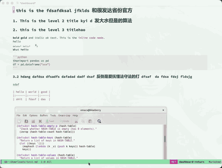

# markdown-plus

Org-mode-like WYSIWYG editing for Markdown, layered on top of
[markdown-mode](https://github.com/jrblevin/markdown-mode).



## Features

- **org-appear-style reveal** — markup is hidden and rendered; the raw
  source of the element at point is revealed and re-hidden as point
  moves. Covers emphasis (`**bold**`, `*italic*`, `_underline_`),
  inline code (`` `code` ``), strikethrough (`~~del~~`),
  subscript/superscript (`~x~` / `^x^`), ATX headings (`#`), links
  (`[text](url)`), images (``), underline (`<u>x</u>`), list
  bullets and GitHub alert markers.
- **Code blocks always verbatim** — fenced blocks (```` ```lang ````)
  keep their fence lines visible and get a distinct background.
- **Inline image preview** — local and remote images, in both the
  Markdown form `` and the HTML form
  ``; the tag's `width` is honoured, capped
  by `markdown-plus-max-image-size`. Remote images are downloaded
  asynchronously and shown when ready.
- **GitHub alerts** — `> [!NOTE]`, `> [!TIP]`, `> [!IMPORTANT]`,
  `> [!WARNING]` and `> [!CAUTION]` render as a coloured label with a
  Nerd Font icon, which degrades to the bare word without such a font.
- **Video links** — Emacs decodes no video format, so an
  `<source src="clip.mp4">` tag renders as a clickable file name
  instead. `RET` or a click hands it to `browse-url`, which reaches the
  system's default player.
- **Anchor links** — `[text](#name)` jumps to `<a id="name">` or
  `<a name="name">` in the same buffer, the form Org and Pandoc emit for
  cross-references, so an exported table of contents is navigable.
  markdown-mode alone ignores bare fragments. Use `C-c C-o` or click the
  link; `C-x C-x` goes back.
- **Table auto-alignment** — GFM tables are aligned when you leave them.

## Requirements

- Emacs 27.1+
- `markdown-mode` 2.6+

## Installation

### With `use-package` (Emacs 30+, `:vc`)

```elisp
(use-package markdown-plus
  :vc (:url "https://github.com/wowhxj/markdown-plus.el.git")
  :hook (markdown-mode . markdown-plus-mode))
```

### With `package-vc-install` (Emacs 29)

On Emacs 29, `use-package` does not yet support `:vc`. Install the
package first, then enable it:

```elisp
(unless (package-installed-p 'markdown-plus)
  (package-vc-install "https://github.com/wowhxj/markdown-plus.el.git"))

(add-hook 'markdown-mode-hook #'markdown-plus-mode)
```

### Manual

Put `markdown-plus.el` on your `load-path`, then:

```elisp
(require 'markdown-plus)
(add-hook 'markdown-mode-hook #'markdown-plus-mode)
```

Or enable it on demand with `M-x markdown-plus-mode` in a Markdown buffer.

## Keybindings

| Key           | Command                          |
|---------------|----------------------------------|
| `C-c C-x C-v` | `markdown-plus-show-images`      |
| `C-c C-x C-r` | `markdown-plus-hide-images`      |
| `s-b`         | `markdown-insert-bold`           |
| `s-i`         | `markdown-insert-italic`         |
| `s-\``        | `markdown-insert-code`           |
| `s-_`         | `markdown-plus-insert-underline` |
| `C-c C-o`     | `markdown-follow-thing-at-point` (markdown-mode's own; anchor links now work) |

On macOS `s-` is the Command key. All four emphasis commands toggle:
they wrap the region or the word at point, and remove the markup again
when point is already inside it.

## Customization

`M-x customize-group RET markdown-plus RET`:

- `markdown-plus-prettify-faces` — enlarge heading faces and shade code
  blocks (default `t`).
- `markdown-plus-auto-preview-images` — render image previews on enable
  (default `t`).
- `markdown-plus-max-image-size` — `(MAX-WIDTH . MAX-HEIGHT)` in pixels.
- `markdown-plus-image-cache-dir` — where remote images are cached.
- `markdown-plus-alert-types` — label and colour per GitHub alert type.

## Tests

```sh
emacs -Q --batch -L . -l test/markdown-plus-test.el \
      -f ert-run-tests-batch-and-exit
```

## License

GPL-3.0-or-later. See [LICENSE](LICENSE) for the full text.
